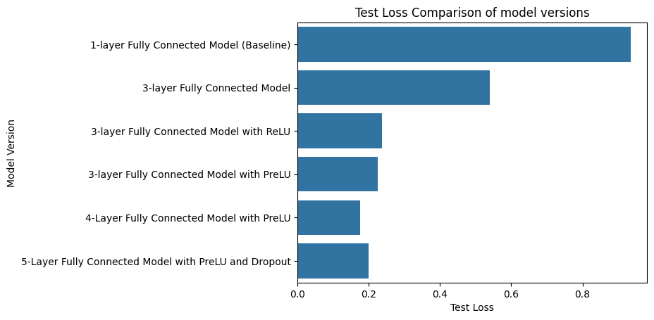
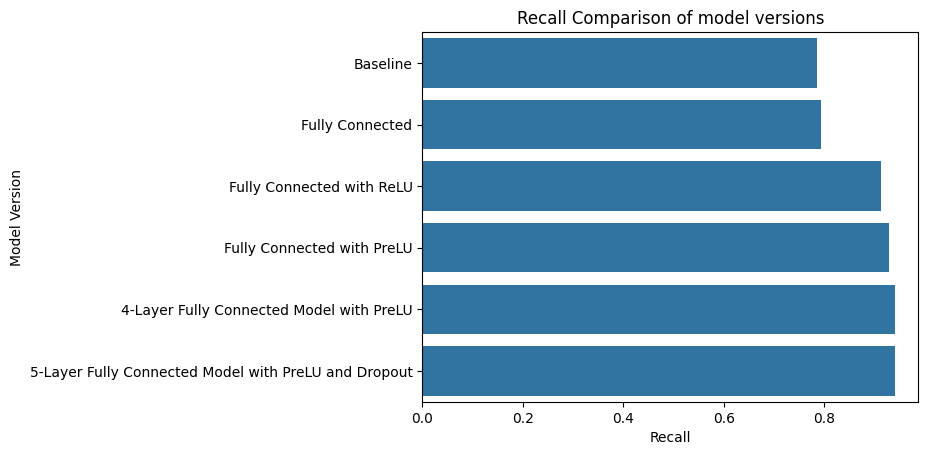
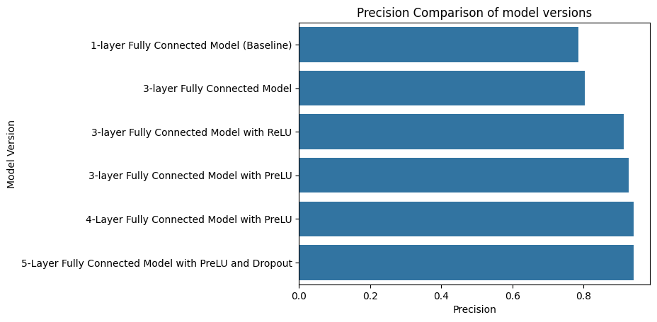
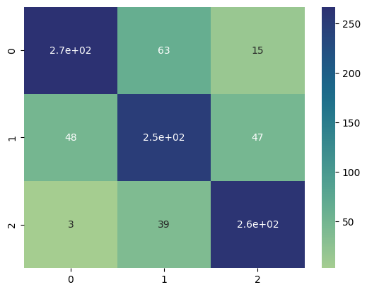
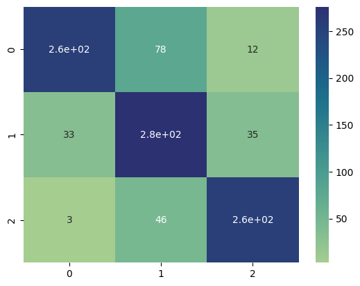
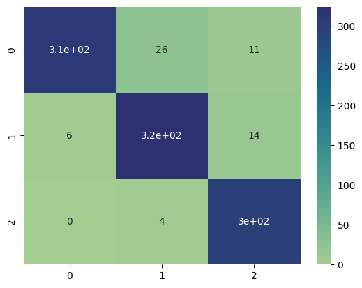

# How Veritas Submission: Foetal Health Predictor

*This project is a prototype and is not medical advice.*

[Google Colab Link](https://colab.research.google.com/drive/1jFqSeEloDA-lw4-yFN2dx0cfFvrVQ89E#scrollTo=MwSZ72pqPkLT) 

Track: Health  
Team N2A: Abhijay Chaudhari, Akhil Divakar, Nathan Newland

## The Problem

The aim of this project is to assist with identifying the health of unborn foetuses for doctors. This is important to help prevent deaths and possibly reduce child mortality rate, which is one of the United Nations’ Sustainable Development Goals.

## What We Built

Our Project takes the results of a cardiotocogram (CTG) as input, and sorts that foetus into one of three health states.

## How it Works

We decided to use the andrewmvd/fetal-health-classification dataset from Kaggle to train our neural network as it contained a decently large amount of samples with a large number of features to improve our model’s accuracy. The dataset contains 2126 records extracted from Cardiotocogram exams, which were classified into 3 classes by expert obstetricians.   
The 3 classes are:

* Normal

* Suspect

* Pathological

On the contrary, one drawback of this dataset was that the classes were imbalanced (there were a much larger number of normal records than suspect and pathological records).   

To remedy this, we handled imbalanced classes by oversampling our data. This generated more data for the Suspect and Pathological classes to make each class have an equal number of samples. 

To begin, we started by training and testing a one-layer fully connected baseline model with 21 input features and 1 output features. After this, we trialled 5 more model versions:

1. 3-layer fully connected model

2. 3-layer fully connected model with ReLU

3. 3-layer fully connected model with PReLU

4. 4-layer fully connected model with PReLU

5. 5-layer fully connected model with PReLU and Dropout

To test our model, we created an API with Fastapi, to provide an interface for our model. We then made a website with React.js, allowing us to input data and see the results. We chose this stack as it was a quick and efficient way to test our model in a real world environment.

## How to run
1. Clone the respository.
2. Inside the API folder, run the following command:
```bash
python -m fastapi dev
```
3. Inside another terminal window, while the API is running. In the Website folder, run the following commands:
```bash
npm install
npm run start
```
4. Open localhost:3000 in a browser, and you should see the website running.

If the submission is stuck processing, make sure your FastAPI URL is set to http://localhost:8000.

## Results

## 

***Fig.1**  Test loss comparison of model versions*

  

***Fig.2**  Recall comparison of model versions*

 

***Fig.3**  Precision comparison of model versions*

  

***Fig.4**  Confusion Matrix for 1-layer Fully Connected Model (Baseline)*

 

***Fig.5**  Confusion Matrix for 3-layer Fully Connected Model*

 

***Fig.6**  Confusion Matrix for 3-layer Fully Connected Model with ReLU*  
 

***Fig.7**  Confusion Matrix for 3-layer Fully Connected Model with PReLU*  
 

***Fig.8**  Confusion Matrix for 4-layer Fully Connected Model with PReLU*  


***Fig.9**  Confusion Matrix for 5-layer Fully Connected Model with PReLU and Dropout Layers*

***Fig. 1*** shows a very large drop in test loss between the baseline model and the 3-layer model. This is likely due to the baseline model underfitting as it is too simple to capture the patterns in the data. As we started to implement activation layers such as ReLU and PReLU, the model loss showed another significant decrease from the 3-layer fully connected model without ReLU, suggesting that the 3-layer model experienced vanishing gradients which was solved by implementing ReLU/PReLU. The 4-layer model then showed the smallest test loss, while the test loss for the 5-layer model with Dropout was larger than the 4-layer model. This could either be due to the 5-layer model overfitting as it has too many parameters for the relatively small dataset, or could be due to the addition of dropout layers.

***Fig. 2*** and ***Fig. 3*** show a similar trend, where there is a significant increase in recall and precision from the baseline model to the 3-layer fully connected model, further proving our conclusion that the baseline underfitted. The 4-layer and 5-layer models both showed increases in precision from the 3-layer models, albeit very small increases.

***Fig. 4, 5, 6, 7, 8*** and ***9*** show that as the model was trained further, the amount of misclassifications decreased dramatically. Our main missed case that we tried to avoid was a foetus being classified as healthy when they were actually pathological. Our later confusion matrices show that no foetuses were misclassified in this way. The diagonals further this, showing our models to become increasingly accurate.

## 

## What We’d Do Next

* Obtain more data so that we can increase model complexity/parameters without overfitting our model.

* Instead of oversampling, find a more balanced dataset as generated data may not properly represent the distribution of the real-world data and therefore, may not be accurate.

* Carry out more research on cardiotocograms to better understand our dataset’s input features.

## References

*Home \| Sustainable Development*. [https\://sdgs.un.org/](https://sdgs.un.org/). Accessed 14 Nov. 2026\.  
Ayres-de-Campos, Diogo, et al. ‘Sisporto 2.0: A Program for Automated Analysis of Cardiotocograms’. *The Journal of Maternal-Fetal Medicine*, vol. 9, no. 5, Sept. 2000, pp. 311–18. *DOI.org (Crossref)*, [https\://doi.org/10.1002/1520-6661(200009/10)9:5%3C311::AID-MFM12%3E3.0.CO;2-9.](https://doi.org/10.1002/1520-6661\(200009/10\)9:5%3C311::AID-MFM12%3E3.0.CO;2-9)  
*Fetal Health Classification*. [https\://www\.kaggle.com/datasets/andrewmvd/fetal-health-classification.](https://www.kaggle.com/datasets/andrewmvd/fetal-health-classification) Accessed 15 Nov. 2026\.  
‘Handling Imbalanced Data for Classification’. *GeeksforGeeks*, 8 July 2020, [https\://www\.geeksforgeeks.org/machine-learning/handling-imbalanced-data-for-classification/](https://www.geeksforgeeks.org/machine-learning/handling-imbalanced-data-for-classification/).  
*PyTorch Documentation — PyTorch Main Documentation*. [https\://docs.pytorch.org/docs/stable/index.html](https://docs.pytorch.org/docs/stable/index.html). Accessed 15 Nov. 2026\.  
‘Duck.Ai’. *Duck.Ai*, https\://duck.ai/. Accessed 15 Nov. 2026\. (Used GPT-6 Luna to explain concepts and debug)  
*FastAPI \- FastAPI*. [https\://fastapi.tiangolo.com/](https://fastapi.tiangolo.com/). Accessed 14 Nov. 2026\.  
‘Material Symbols and Icons’. *Google Fonts*, [https\://fonts.google.com/icons](https://fonts.google.com/icons). Accessed 14 Nov. 2026\.  
*React*. [https\://react.dev/](https://react.dev/). Accessed 14 Nov. 2026\.